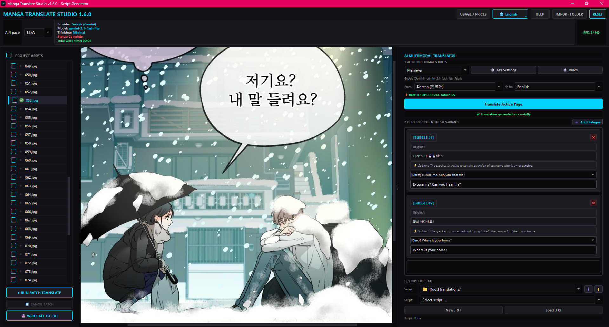

# 🌌 Manga Translate Studio (MTS)
**Next-Generation Multimodal AI Vision Translation Suite for Comics, Manga & Webtoons**

[](https://opensource.org/licenses/Apache-2.0)
[](https://www.python.org/)
[-green)](https://www.qt.io/)
[](https://github.com/NeTRuNNeRGLiTCH/manga-cleaner)

---

## 📖 Overview

**Manga Translate Studio (MTS)** is a desktop scanlation workbench built with **Python 3.12** and **PySide6 (Qt6)**. Designed as a dedicated companion and sibling application to **Manga Cleaner**, MTS bridges raw comic image extraction with multimodal Vision LLMs through Google Gemini and Ollama.

Instead of relying on standalone, error-prone OCR engines, MTS performs direct multimodal image analysis. It identifies visual speech bubbles, narration boxes, floating outside text, and comic sound effects (SFX), translating and structuring them into standard script files (`.txt`) ready for typesetting or direct import into [Manga Cleaner Studio](https://github.com/NeTRuNNeRGLiTCH/manga-cleaner).

The interface locale is separate from the source and target languages used to translate manga. Ten interface languages are currently listed in `locales/index.json`. The runtime reads this small language index and loads only the selected catalog, keeping memory use low. See [TRANSLATION.md](TRANSLATION.md) for catalog verification and contribution. English is the fallback if a selected catalog cannot be verified.

---

## 🖥️ Studio Workflow & Interface




---

## ✨ Key Features

* **Multimodal Vision Translation**: Direct image parsing without intermediate OCR steps. Supports Google Gemini (`gemini-3.1-flash-lite`, `gemini-3.5-flash-lite`, `gemini-3.8-flash`, `etc`) and Ollama instances (Localhost LAN and OpenAI-compatible `/v1` cloud endpoints).
* **Inter-Page Continuity Injection**: Automatically extracts and injects trailing dialogues from previous pages into inference prompts, guaranteeing seamless grammatical continuity across panel breaks.
* **Strict Format Preservation**: Generates and edits translation scripts strictly inside compliant `<translation> ... </translation>` tags, preserving editorial headers and notes for seamless ingestion in Manga Cleaner Studio.
* **Two-Tier Script Organization**: Cleanly separates projects into `translations/<Series>/<Chapter>.txt`, allowing multi-chapter workspaces to remain organized without directory clutter.
* **Adaptive Batch Orchestration**: Sequential chapter-level translation featuring adaptive cadence pacing to prevent HTTP 429 rate limits, with immediate halts on Daily Quota (`RPD`) exhaustion to protect API budgets.
* **Custom Lore & Style Rules**: Dedicated user rules workspace (`cache/user_rules.txt`) to customize character voices, glossary terms, pronouns, and scanlation tone without bloating the technical core engine prompt.
* **Saved Connection Profiles**: Switch between saved provider credentials, endpoints, models, and model settings. Usage history and Gemini RPD are tracked per connection profile.
* **Configurable Prompt Options**: Preview the generated system prompt and toggle extraction features, including SFX meanings, duplicate SFX suppression, and contextual R19 vocalization guidance.
* **Usage & Pricing**: Review provider-reported token and cache usage, estimate costs from editable USD-per-million-token rates, and import or export community JSON price tables.
* **Gemini Request Meter**: Optional local requests-per-day (RPD) limit and usage count, editable in API Settings and grouped by saved connection profile and model.
* **Reviewable Batch Work**: Inspect completed pages while a batch continues; pending and active pages remain locked. Wheel scrolling navigates long pages, and `Ctrl` or `Alt` + wheel zooms the canvas.
* **Dynamic Provider Extensibility**: Fully decoupled backend architecture allowing community contributors to add new AI providers and language pairs via clean abstract classes.
* **Upcoming provider scaffolds**: OpenAI (ChatGPT), xAI (Grok), Anthropic (Claude), OpenRouter, and DeepSeek are listed in API Settings as unavailable placeholders. They do not make API calls; see Help → Providers & Contribution to learn how to contribute an implementation.

See [CHANGELOG_1.6.0.md](CHANGELOG_1.6.0.md) for the detailed 1.6.0 change list.

---

## 📂 Project Directory Structure

```text
Manga Translate Studio/
├── .github/
│   └── Ui.png                         # Repository UI screenshot
├── .gitignore                          # Excludes local credentials, history, and generated files
├── assets/                            # Application icons and branding
├── locales/                           # UI language catalogs
│   ├── en.json                        # English source strings and primary language
│   ├── <language>.json                # Additional catalogs; see index.json
│   └── index.json                     # Available languages and source fingerprints
├── Pricing_Models_Providers/          # Community JSON price references for import
│   ├── PRICING_TABLES.md              # Price schema, import behavior, and contribution guidance
│   ├── google_models.json             # Google Gemini and Gemma reference rates
│   └── ollama_models.json             # Ollama Cloud reference rates
├── cache/                             # Runtime user data (git-ignored; created by the app)
│   ├── api_config.json                # Provider settings and saved connection profiles
│   ├── core_rules.txt                 # Technical prompt rules
│   ├── pricing_tables.json            # Imported/editable prices and Gemini RPD settings
│   ├── prompt_options.json            # Extraction and prompt feature toggles
│   ├── ui_settings.json               # Saved interface locale (created when changed)
│   ├── usage_history.json             # Local request and token history
│   └── user_rules.txt                 # User glossary, lore, and style rules
├── logs/                              # Runtime diagnostics (git-ignored)
├── translations/                      # User translation scripts (git-ignored)
├── processed/                         # Output staging directory (git-ignored)
├── src/
│   ├── backend/
│   │   ├── providers/
│   │   │   ├── base_provider.py       # Provider interface and normalized result schema
│   │   │   ├── anthropic_provider.py  # Unavailable provider scaffold for Claude
│   │   │   ├── deepseek_provider.py   # Unavailable provider scaffold for DeepSeek
│   │   │   ├── gemini_provider.py     # Gemini Vision API, thinking levels and usage metadata
│   │   │   ├── openai_provider.py     # Unavailable provider scaffold for OpenAI
│   │   │   ├── ollama_provider.py     # Ollama local and OpenAI-compatible cloud integration
│   │   │   ├── openrouter_provider.py # Unavailable provider scaffold for OpenRouter
│   │   │   └── xai_provider.py        # Unavailable provider scaffold for xAI
│   │   ├── ai_client.py               # Provider orchestration, request pacing and workers
│   │   ├── credential_manager.py      # Persistent settings and connection profiles
│   │   ├── languages.py               # Supported languages and localized SFX directives
│   │   ├── prompt_manager.py          # Prompt construction, options and continuity context
│   │   ├── translator.py              # Translation UI, prompt configuration and script engine
│   │   └── usage_manager.py           # Pricing, usage history, cache data and Gemini RPD state
│   ├── frontend/
│   │   ├── api_settings.py            # Provider, connection profile and model settings dialog
│   │   ├── canvas.py                  # Image viewport, scrolling and Ctrl/Alt+wheel zoom
│   │   ├── help_system.py             # In-app guide for navigation, prompts and usage
│   │   ├── main_window.py             # Main UI, batch workflow, pacing and RPD controls
│   │   ├── project_reset.py           # Project/session reset and memory cleanup
│   │   ├── styles.qss                 # Application visual theme
│   │   ├── usage_pricing.py           # Usage history, price editor and JSON import/export
│   │   └── widgets.py                 # SVG icon provider and project asset list
│   └── utils/
│       ├── config.py                  # Global constants, version and color palette
│       ├── i18n.py                    # Verified JSON locale loading and fallback
│       ├── logger.py                  # Runtime logging
│       └── paths.py                   # Source/frozen path resolver
├── tools/
│   ├── check_locales.py               # Catalog structure and release verification
│   ├── extract_strings.py             # UI string extraction and review report
│   └── migrate_to_tr.py               # Dry-run-first UI localization migration
├── build_exe.py                       # PyInstaller packaging script
├── CONTRIBUTING.md                    # Contribution and pull request guidelines
├── TRANSLATION.md                     # UI localization and catalog verification guide
├── CHANGELOG_1.6.0.md                 # Detailed changes in version 1.6.0
├── TECHNICAL_AUDIT_1.6.0.md           # Maintenance audit and follow-up notes
├── generate_icons.py                  # Application icon generation utility
├── LICENSE                            # Apache License 2.0
├── main.py                            # Application entry point
├── README.md                          # Project overview and setup guide
└── requirements.txt                   # Runtime dependencies
```

---

## 🤝 Sibling Ecosystem & Credits

**Manga Translate Studio** is a sibling project to **Manga Cleaner Studio**, sharing design language, technical principles, and file conventions.

**Repository:** [Manga Cleaner Studio on GitHub](https://github.com/NeTRuNNeRGLiTCH/manga-cleaner)

We would like to give credit to the original creators and key contributors of the ecosystem:

* **[NeTRuNNeRGLiTCH](https://github.com/NeTRuNNeRGLiTCH)**: Creator of the original [Manga Cleaner Studio](https://github.com/NeTRuNNeRGLiTCH/manga-cleaner) project and the base studio architecture.
* **[MavikBow](https://github.com/MavikBow)**: Original creator of the multi-task batch queue system, dark theme stabilization, and UI enhancement architecture introduced in Manga Cleaner Studio v3.2.0.
* **[santiagodvergara05-debug](https://github.com/santiagodvergara05-debug)**: Core contributor to Manga Cleaner Studio (v3.2.0 canvas stabilization and author of the upcoming [Manga Cleaner Studio v3.3.2 Workspaces](https://github.com/santiagodvergara05-debug/manga-cleaner/tree/ver3.3.x)), and lead architect of **Manga Translate Studio**.

> *Note: Manga Cleaner Studio v3.3.2 (with Typesetting workspaces) is currently maintained in the developer's [ver3.3.x branch](https://github.com/santiagodvergara05-debug/manga-cleaner/tree/ver3.3.x) pending upstream review.*

---

## 🚀 Getting Started

### 1. Prerequisites

* Python 3.10, 3.11, or 3.12 (64-bit recommended).
* Git installed on your system.

### 2. Clone the Repository

```bash
git clone [https://github.com/santiagodvergara05-debug/manga-translate-studio.git](https://github.com/santiagodvergara05-debug/manga-translate-studio.git)
cd manga-translate-studio

```

### 3. Setup Virtual Environment

```bash
python -m venv venv

# Windows:
.\venv\Scripts\activate

# Linux / macOS:
source venv/bin/activate

```

### 4. Install Dependencies

```bash
pip install -r requirements.txt

```

### 5. Run from Source

```bash
python main.py

```

---

## 📦 Portable Windows Build (`.EXE` package)

Manga Translate Studio features an isolated build configuration designed to coexist **in the exact same directory** as Manga Cleaner without dependency collisions:

```bash
python -m pip install PyInstaller
python build_exe.py

```

### How Coexistence Works

`build_exe.py` validates the localization catalogs before packaging, then places runtime dependencies and bundled resources in an isolated `MangaTranslate_Data/` folder. The executable depends on that folder and must not be distributed by itself. For a release, archive and upload the **entire `dist/MangaTranslate/` directory**:

```text
dist/
└── MangaTranslate/              # Archive this entire folder for release
    ├── MangaTranslate_Data/     # Isolated dependencies, assets, styles, and locales
    ├── cache/                   # Persistent app settings and runtime data
    ├── logs/                    # Diagnostics
    ├── translations/            # Translation scripts (.txt)
    ├── processed/               # Processed output
    └── MangaTranslate.exe       # Application launcher

```

Keep Manga Cleaner and Manga Translate Studio in separate application folders. Their packaged dependencies are isolated; users can still select the same translation-script folder from either application when needed.

---

## ⌨️ Keyboard Shortcuts

| Shortcut | Description |
| --- | --- |
| `Hold [Space]` | Toggle hand tool for smooth canvas panning |
| `Mouse Wheel` | Scroll vertically through long pages |
| `Ctrl + Mouse Wheel` | Zoom centered on the cursor |
| `Middle Click` | Reset canvas zoom scale to 1:1 original size |
| `Space + Click Drag` | Pan across ultra-high-resolution pages |

---

## 📜 License

Distributed under the **Apache License 2.0**. See the [LICENSE](https://www.google.com/search?q=LICENSE) file for more details.

```text
Copyright 2026 santiagodvergara05-debug

Licensed under the Apache License, Version 2.0 (the "License");
you may not use this file except in compliance with the License.
You may obtain a copy of the License at

    [http://www.apache.org/licenses/LICENSE-2.0](http://www.apache.org/licenses/LICENSE-2.0)

```

