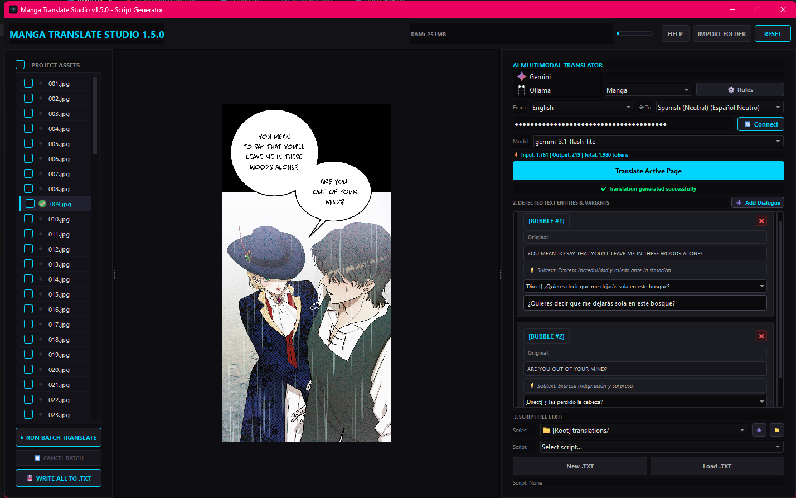

# 🌌 Manga Translate Studio (MTS)
**Next-Generation Multimodal AI Vision Translation Suite for Comics, Manga & Webtoons**

[](https://opensource.org/licenses/Apache-2.0)
[](https://www.python.org/)
[-green)](https://www.qt.io/)
[](https://github.com/NeTRuNNeRGLiTCH/manga-cleaner)

---

## 📖 Overview

**Manga Translate Studio (MTS)** is a desktop scanlation workbench built with **Python 3.12** and **PySide6 (Qt6)**. Designed as a dedicated companion and sibling application to **Manga Cleaner**, MTS bridges raw comic image extraction with state-of-the-art multimodal Vision LLMs (Google Gemini and Ollama).

Instead of relying on standalone, error-prone OCR engines, MTS performs direct multimodal image analysis. It identifies visual speech bubbles, narration boxes, floating outside text, and comic sound effects (SFX), translating and structuring them into standard script files (`.txt`) ready for typesetting or direct import into [Manga Cleaner](https://github.com/NeTRuNNeRGLiTCH/manga-cleaner).

---

## 🖥️ Studio Workflow & Interface (v1.5.0 UI)




---

## ✨ Key Features

* **Multimodal Vision Translation**: Direct image parsing without intermediate OCR steps. Supports Google Gemini (`gemini-3.1-flash-lite`, `gemini-3.5-flash-lite`, `gemini-3.8-flash`, `etc`) and Ollama instances (Localhost LAN and OpenAI-compatible `/v1` cloud endpoints).
* **Inter-Page Continuity Injection**: Automatically extracts and injects trailing dialogues from previous pages into inference prompts, guaranteeing seamless grammatical continuity across panel breaks.
* **Strict Format Preservation**: Generates and edits translation scripts strictly inside compliant `<translation> ... </translation>` tags, preserving editorial headers and notes for seamless ingestion in Manga Cleaner.
* **Two-Tier Script Organization**: Cleanly separates projects into `translations/<Series>/<Chapter>.txt`, allowing multi-chapter workspaces to remain organized without directory clutter.
* **Adaptive Batch Orchestration**: Sequential chapter-level translation featuring adaptive cadence pacing to prevent HTTP 429 rate limits, with immediate halts on Daily Quota (`RPD`) exhaustion to protect API budgets.
* **Custom Lore & Style Rules**: Dedicated user rules workspace (`cache/user_rules.txt`) to customize character voices, glossary terms, pronouns, and scanlation tone without bloating the technical core engine prompt.
* **Dynamic Provider Extensibility**: Fully decoupled backend architecture allowing community contributors to add new AI providers and language pairs via clean abstract classes.

---

## 📂 Project Directory Structure

```text
Manga Translate Studio/
├── assets/                          # Application vector icons (SVG Tiny) and branding
│   └── icon_provider/               # AI provider logos (gemini.svg, ollama.svg, etc.)
├── cache/                           # User rules, core rules, and persistent API configs (git-ignored)
├── logs/                            # Diagnostic runtime logs and session traces (git-ignored)
├── translations/                    # Series folders and exported .txt script templates (git-ignored)
├── processed/                       # Output staging directory (git-ignored)
├── src/
│   ├── backend/
│   │   ├── providers/
│   │   │   ├── base_provider.py     # BaseAIProvider interface and TranslationResult schema
│   │   │   ├── gemini_provider.py   # Google Gemini Vision REST API integration
│   │   │   └── ollama_provider.py   # Ollama local daemon & OpenAI-compatible cloud client
│   │   ├── ai_client.py             # Orchestration manager, token estimator & QThread workers
│   │   ├── credential_manager.py    # Deep-merged JSON configuration persistence
│   │   ├── languages.py             # ISO language definitions and localized SFX rules
│   │   ├── prompt_manager.py        # Reading orders, core extraction rules & continuity context
│   │   └── translator.py            # Dialogue cards UI panel, script parser & sync engine
│   ├── frontend/
│   │   ├── canvas.py                # High-resolution GraphicsScene viewport with boundary clamping
│   │   ├── help_system.py           # In-app user manual and keyboard shortcut reference
│   │   ├── main_window.py           # Primary studio controller and batch state machine
│   │   ├── project_reset.py         # Memory cleanup controller and glibc heap trimmer
│   │   ├── styles.qss               # Deep Obsidian visual theme stylesheet
│   │   └── widgets.py               # Dynamic SVG IconProvider, FileListWidget & RAM telemetry
│   └── utils/
│       ├── config.py                # Global constants, versioning, and color palette
│       ├── history.py               # Undo/redo session state stack
│       ├── logger.py                # Thread-safe diagnostic logging with status flags
│       ├── paths.py                 # Dynamic path resolver for source and frozen environments
│       └── system_info.py           # Process RSS memory monitoring via psutil
├── build_exe.py                     # PyInstaller automated packaging script
├── CONTRIBUTING.md                  # Guidelines for Pull Requests and Code of Conduct
├── LICENSE                          # Apache License 2.0 legal terms
├── main.py                          # Application bootstrap entry point
└── requirements.txt                 # Runtime dependencies

```

---

## 🤝 Sibling Ecosystem & Credits

**Manga Translate Studio** is designed as a direct sister application to **Manga Cleaner**, sharing design language, technical principles, and file conventions.

We would like to give credit to the original creators and key contributors of the ecosystem:

* **[NeTRuNNeRGLiTCH](https://github.com/NeTRuNNeRGLiTCH)**: Creator of the original [Manga Cleaner](https://github.com/NeTRuNNeRGLiTCH/manga-cleaner) project and the base studio architecture.
* **[MavikBow](https://github.com/MavikBow)**: Original creator of the multi-task batch queue system, dark theme stabilization, and UI enhancement architecture introduced in Manga Cleaner v3.2.0.
* **[Santiago Daniel Vergara (santiagodvergara05-debug)](https://www.google.com/search?q=https://github.com/santiagodvergara05-debug)**: Core contributor to Manga Cleaner (v3.2.0 canvas stabilization and author of the upcoming [Manga Cleaner v3.3.2 Studio Workspaces](https://www.google.com/search?q=https://github.com/santiagodvergara05-debug/manga-cleaner/tree/ver3.3.x)), and lead architect of **Manga Translate Studio**.

> *Note: Manga Cleaner v3.3.2 (with Typesetting workspaces) is currently maintained in the developer's [ver3.3.x branch](https://www.google.com/search?q=https://github.com/santiagodvergara05-debug/manga-cleaner/tree/ver3.3.x) pending upstream review.*

---

## 🚀 Getting Started

### 1. Prerequisites

* Python 3.10, 3.11, or 3.12 (64-bit recommended).
* Git installed on your system.

### 2. Clone the Repository

```bash
git clone [https://github.com/santiagodvergara05-debug/manga-translate-studio.git](https://github.com/santiagodvergara05-debug/manga-translate-studio.git)
cd manga-translate-studio

```

### 3. Setup Virtual Environment

```bash
python -m venv venv

# Windows:
.\venv\Scripts\activate

# Linux / macOS:
source venv/bin/activate

```

### 4. Install Dependencies

```bash
pip install -r requirements.txt

```

### 5. Run from Source

```bash
python main.py

```

---

## 📦 Standalone Portable Compilation (`.EXE`)

Manga Translate Studio features an isolated build configuration designed to coexist **in the exact same directory** as Manga Cleaner without dependency collisions:

```bash
python build_exe.py

```

### How Coexistence Works

Standard PyInstaller builds place shared DLLs inside an `_internal/` directory. To prevent overwriting Manga Cleaner's dependencies, `build_exe.py` encapsulates all runtime libraries into an isolated folder:

```text
MangaCleaner_CPU 3.3.2/
├── _internal/                   # Manga Cleaner runtime libraries (untouched)
├── MangaTranslate_Data/         # Manga Translate Studio runtime libraries (isolated)
├── cache/                       # Shared persistent cache
├── logs/                        # Shared diagnostics
├── translations/                # Shared translation scripts (.txt)
├── MangaCleaner_CPU.exe         # Cleaner binary
└── MangaTranslate.exe           # Translator binary

```

Both tools run independently from the same root directory while seamlessly sharing project scripts and cache files.

---

## ⌨️ Keyboard Shortcuts

| Shortcut | Description |
| --- | --- |
| `Hold [Space]` | Toggle hand tool for smooth canvas panning |
| `Mouse Wheel` | Smooth incremental zoom centered on cursor |
| `Middle Click` | Reset canvas zoom scale to 1:1 original size |
| `Space + Click Drag` | Pan across ultra-high-resolution pages |

---

## 📜 License

Distributed under the **Apache License 2.0**. See the [LICENSE](https://www.google.com/search?q=LICENSE) file for more details.

```text
Copyright 2026 Santiago Daniel Vergara

Licensed under the Apache License, Version 2.0 (the "License");
you may not use this file except in compliance with the License.
You may obtain a copy of the License at

    [http://www.apache.org/licenses/LICENSE-2.0](http://www.apache.org/licenses/LICENSE-2.0)

```

